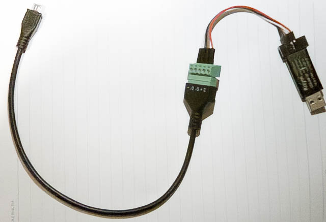
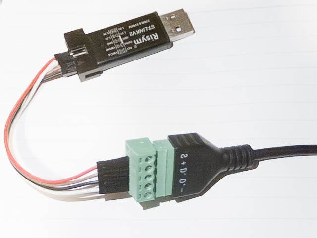

# 构建与烧录指南（macOS / Linux）

本文档介绍如何在 macOS / Linux 下脱离 STM32CubeIDE，使用命令行工具链编译与烧录 `c3m1-firmware`。

---

## 1. 安装工具链

- **macOS**：
  ```bash
  brew install --cask gcc-arm-embedded
  brew install openocd
  ```
- **Ubuntu / Debian**：
  ```bash
  sudo apt update
  sudo apt install gcc-arm-none-eabi libnewlib-arm-none-eabi make openocd
  ```

---

## 2. 编译固件

```bash
make -j
```

构建产物输出至 `build/` 目录：
- `build/c3m1_camera.elf`（带调试符号）
- `build/c3m1_camera.hex`（ST-Link 烧录推荐）
- `build/c3m1_camera.bin`（裸二进制）
- `build/c3m1_camera.map`（内存与符号映射表）
- `build/fw_version.h`（自动生成）

### 版本号与短哈希自动注入
`Makefile` 在每次编译前会自动生成 `build/fw_version.h`（带 `cmp -s` 变更检测，未变化时不触发多余重编）：
- `FW_VERSION_STR` / `FW_VER_MAJOR` / `FW_VER_MINOR` / `FW_VER_PATCH`：由 `Makefile` 中的 `FW_VERSION`（当前 `v0.1.16`，可通过 `make FW_VERSION=vX.Y.Z` 覆盖）解析，既用于开机画面与菜单底栏显示，也写入 SD 卡二进制配置 `0:CAYE_CFG/c3m1.cfg` 做固件版本校验。
- `FW_GIT_HASH_STR`：来自 `git rev-parse --short HEAD`；当工作区存在未提交改动时自动追加 `-dirty` 后缀（例如 `cf8b90d-dirty`），便于区分正式构建与本地调试版本。

如需清理全部构建产物：
```bash
make clean
```

---

## 3. 实机屏幕批次微调（可选）

若不同批次 2.0" ST7789V3 屏幕出现颜色反转或方向偏差，只需修改 `Drivers/BSP/LCD/lcd.h` 中对应宏后重新 `make -j`（无需改动业务逻辑）：
- `LCD_ST7789_INVERSION`：`1` 开启反相 (`0x21`，IPS 屏常用) / `0` 关闭反相 (`0x20`)
- `LCD_ST7789_RGB_ORDER`：`0x00` (RGB) / `0x08` (BGR)
- 如需上下 180° 翻转取景画面，可在 `Drivers/BSP/LCD/lcd.c` 的 `lcd_display_dir(1)` 中调整默认扫描方向。

---

## 4. SWD 烧录（MicroUSB 复用口）

> **安全警告**：
> 1. 主板 MicroUSB (`USB1`) 的 `VBUS` 直连 **`VCC3.3`**，**严禁直接插电脑 5V USB 口**！请仅通过外部 ST-Link / CMSIS-DAP 的 3.3V SWD 接口连接（引脚定义：`Pin1=3.3V, Pin2=SWDIO, Pin3=SWCLK, Pin4=NRST, Pin5=GND`；关机/开机供电接线区别见下文）。
> 2. **切勿使用 OTG MicroUSB 线**：MicroUSB `Pin4 (ID)` 在主板上直连 STM32 `NRST`，OTG 线内部将 `ID` 与 `GND` 短接会导致芯片被永久拉低复位而无法连接烧录（OpenOCD 报 `Halt timed out` / `DHCSR=0x02010001`）。请使用普通 **4 芯非 OTG MicroUSB 线**（悬空 `NRST`），配合 `reset_config none` 即可稳定烧录。

### 固件刷写用线材和连线示例

推荐使用 **非 OTG 免焊 MicroUSB 端子线 + 4 根公对母杜邦线** 连接 ST-Link V2（或 CMSIS-DAP）进行刷写，无需焊接即可稳定复接：

- **线材挑选注意**：具有 5pin 绿端子的免焊 MicroUSB 线，第 5 个引脚（常标为 `S`）往往并未引出 `ID` 引脚，而是引出了 MicroUSB 接口的金属外壳屏蔽层；只需用万用表确认线材内部 **`ID` 引脚悬空（未与 `GND` 短接）** 即可正常使用，端子上的 `S` 脚保持悬空不接。
- **4 线接线对照**（仅需接以下 4 根线，切勿误接 ST-Link 的 `5.0V`）：

| MicroUSB 端子丝印 | MicroUSB 引脚 | C3M1 主板信号 | ST-Link V2 引脚 | 示例图线色 / 说明 |
| :---: | :---: | :---: | :---: | :--- |
| **`+`** | `Pin 1 (VBUS)` | **`VCC3.3`** | **`3.3V`** | 示例红线；**仅关机烧录时接**，严禁接 `5.0V` |
| **`D-`** | `Pin 2 (D-)` | **`SWDIO`** | **`SWDIO`** | 示例棕线 |
| **`D+`** | `Pin 3 (D+)` | **`SWCLK`** | **`SWCLK`** | 示例黑线 |
| **`-`** | `Pin 5 (GND)` | **`GND`** | **`GND`** | 示例白线 |
| `ID` / `S` | `Pin 4` / 外壳 | `NRST` / 屏蔽 | **不接（悬空）** | 配合 `reset_config none` 无需接 `NRST` |

- **机身电源开关 `SW4` 开启 vs 关闭时的接线区别（重要）**：

| 机身电源开关 `SW4` 状态 | 接线方式 | 说明与注意事项 |
| :--- | :--- | :--- |
| **关闭（推荐）** | **接 4 线**：`+ (3.3V)`、`D- (SWDIO)`、`D+ (SWCLK)`、`- (GND)` | 由 ST-Link 的 `3.3V` 引脚单独给主板 `VCC3.3`（STM32）供电，无双电源冲突、不受休眠影响；由于屏幕背光与摄像头由电池升压轨 `VCC5.0` 供电，**关机刷写时黑屏属正常现象**，刷完拔线再开机即可。 |
| **开启（电池供电）** | **仅接 3 线**：`D- (SWDIO)`、`D+ (SWCLK)`、`- (GND)`，**断开 `+ (3.3V)` 红线** | 常见铝壳 ST-Link V2 的 `3.3V` 脚为 **LDO 电源输出**，开机时主板 `AMS1117-3.3V` 也在向 `VCC3.3` 输出 3.3V，切勿把两路 3.3V 输出直接并联以免压差反灌发热或损坏 LDO；开机状态下刷完可直接复位亮屏看效果。<br>（例外：原装 ST-Link / J-Link 等带高阻 `VTref / TVCC` 电平检测脚的调试器不对外供电，开机刷写时仍需接 `VTref` 脚以检测目标板电平。） |

- **上电与连接提示**：
  1. 拧紧端子后，首次使用前建议先用万用表确认 `+` 与 `-` 无短路，且 ST-Link 端确认插在 **`3.3V`** 而非相邻的 `5.0V`。
  2. 开机刷写时，若相机已自动进入低功耗休眠，SWD 可能报 `unable to connect to the target`；先短按 `ASA` 唤醒相机后再执行烧录命令。

附图（使用 C3M1 拍摄，固件版本 `v0.1.16`）：

**已经连好的线材（免焊 MicroUSB 端子线 + 杜邦线 + ST-Link V2）：**



**5pin 免焊端子与 ST-Link V2 引脚特写（`S` 脚悬空；图示为关机刷写的 `- / D+ / D- / +` 四线接法，若开机电池供电则断开红线 `3.3V`）：**



### 直接烧录 GitHub Release 预编译固件（免编译）
若无需本地编译，可直接从 GitHub Releases 下载对应版本的 `c3m1_camera_vX.Y.Z.hex`（及 `SHA256SUMS.txt` 校验完整性）后烧录：
- **OpenOCD + ST-Link（命令行）**：
  ```bash
  shasum -a 256 -c SHA256SUMS.txt   # Linux 可用 sha256sum -c SHA256SUMS.txt
  openocd -f interface/stlink.cfg -f target/stm32f1x.cfg \
    -c "reset_config none; program c3m1_camera_vX.Y.Z.hex verify reset exit"
  ```
- **STM32CubeProgrammer / J-Flash**：接口选择 **SWD**，Reset Mode 选择 **Software system reset**，烧录 `c3m1_camera_vX.Y.Z.hex`（或 `c3m1_camera_vX.Y.Z.bin` 指定起始地址 `0x08000000`）。

### 使用 ST-Link V2（源码构建后推荐）
```bash
make flash-stlink
```
（已内置 `interface/stlink.cfg`、`target/stm32f1x.cfg` 与 `reset_config none`，自动校验并复位启动。）

### 使用 CMSIS-DAP / DAPLink
```bash
make flash
```
（使用仓库根目录的 `dap.cfg`。）

### 恢复出厂固件
如需恢复出厂固件，直接烧录原资料包中的 `软件部分/C3M1生产烧录.hex`，或使用 [c3m1-factory-patch/](./c3m1-factory-patch/README.md) 中已验证的定向补丁版。

---

## 5. 串口调试日志（可选，默认关闭）
- 生产构建默认 `DEBUG_LOG=0`（编译宏 `C3M1_DEBUG_LOG=0`），完全裁剪 `USART1` 初始化与 `printf`（节省 Flash 与运行期阻塞耗时）。
- 需要查看串口调试日志时，使用以下命令重新编译烧录：
  ```bash
  make clean && make DEBUG_LOG=1 -j
  ```
- 引脚：`USART1`（`PA9=TX`、`PA10=RX`），波特率 `115200 8N1`。开启后打印固件版本号与哈希、电池电压、SDIO 速率与挂载状态、`CAYE_CFG/c3m1.cfg` 校验结果及写卡耗时。
